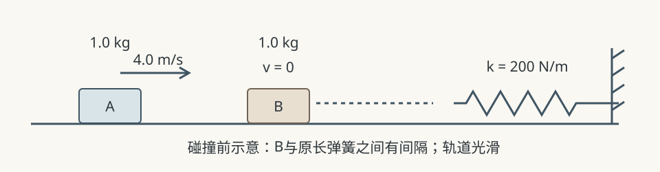

# 原创物理素材：碰撞与弹簧

以下是本次自编的候选素材与题设值，不是实测记录。供主老师选择、改编，题目的排列不强制课堂顺序。完整核算见相邻的教师底稿。

## 素材一：两种碰撞的结果对照

在水平光滑轨道上，两滑块A、B质量均为1.0 kg。碰前A向右以4.0 m/s运动，B静止。考虑两种不同碰头的理想化碰撞模型，以下给出其碰后结果：

| 模型 | A碰后速度 | B碰后速度 |
|---|---|---|
| 弹性碰撞、碰后分离 | 0 | 向右4.0 m/s |
| 完全非弹性碰撞、碰后粘连 | 向右2.0 m/s | 向右2.0 m/s |

碰撞期间两滑块组成的系统所受水平外力可忽略。比较两种模型碰前、碰后的总动量和总动能。哪些量相同、哪些不同？“没有摩擦”是否足以说明碰撞时动能不变？

## 素材二：粘连后压缩弹簧

水平轨道光滑，轻质理想弹簧右端固定于墙，左端自由，初始处于原长，劲度系数k=200 N/m。滑块A、B质量均为1.0 kg，碰前A以4.0 m/s向右运动，B静止。两滑块碰撞后牢固粘连。碰撞发生时两滑块均尚未接触弹簧；碰撞过程极短，水平外力可忽略。粘连体继续滑行，之后接触并压缩弹簧，压缩阶段无摩擦或其他机械能耗散，墙固定不动。滑块可视为质点，忽略弹簧质量。

1. 求碰撞后共同速度，以及碰撞过程中减少的动能。
2. 求弹簧第一次达到的最大压缩量，说明所选研究对象和起止时刻。
3. 最大压缩瞬间，粘连体速度为零。它此时是否处于平衡？说明依据。

## 素材三：增加一段粗糙轨道

沿用素材二的质量、碰前速度、碰撞方式和弹簧参数。唯一改动是：粘连体在碰撞结束后、接触弹簧前，完整通过一段长L=0.30 m的水平粗糙轨道，动摩擦因数mu=0.50；其他轨道仍光滑，压缩弹簧时无摩擦。取g=10 m/s²，把粘连体视为质点，粗糙段内受到的滑动摩擦力为mu(mA+mB)g。碰撞仍发生于光滑段且尚未接触弹簧。

判断粘连体能否到达弹簧；若能，求第一次最大压缩量。解释这里哪些阶段需要改变所用关系，并与光滑情形比较。

## 可选条件变化

若仅将粗糙段长度改为L=0.50 m，其他条件不变，粘连体还会压缩弹簧吗？这是可选边界材料，非本课必做。
