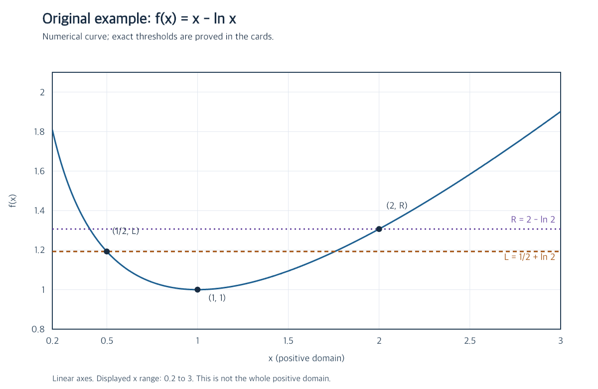

# 变化区间上的最值

## 内容

### 原题

**原创示例题。** 设 $a>0$，$f(x)=x-\ln x$。求 $f$ 在闭区间 $[a,2a]$ 上的最小值、最大值及各自取得的位置。请说明分类的依据，而不只给出结果。

参考理解：先尝试，再展开推导与函数图

## 参考理解

### 原解

**从特征想到什么。** 函数不随 $a$ 改变，变化的是区间。遇到这种题，先研究整条曲线，再看区间与转折点的相对位置，比对每个 $a$ 重新求导更清楚。

定义域为 $x>0$，且

$$f'(x)=1-\frac1x=\frac{x-1}{x}.$$

分母为正，所以 $f$ 在 $(0,1]$ 严格递减，在 $[1,+\infty)$ 严格递增，$f(1)=1$。驻点是候选位置，还要看它是否落入题目指定区间。

**先做位置分类。** 当 $0<a\leq\tfrac12$，整个区间在递减段，最小值是 $f(2a)$，最大值是 $f(a)$。当 $a\geq1$，整个区间在递增段，最小值是 $f(a)$，最大值是 $f(2a)$。当 $\tfrac12<a<1$，区间跨过 $1$，最小值为 $1$，在 $x=1$ 取得；最大值还须比较两端点。

**再比较端点。** 不能因为两端点分居 $1$ 两侧就说它们一样高。直接相减最清楚：

$$f(2a)-f(a)=(2a-\ln(2a))-(a-\ln a)=a-\ln2.$$

由 $\tfrac12<\ln2<1$，端点换位确实发生在跨驻点那一段。于是完整结论为：

$$
\min_{[a,2a]}f=
\begin{cases}
2a-\ln(2a),&0<a\leq\tfrac12,\\
1,&\tfrac12<a<1,\\
a-\ln a,&a\geq1.
\end{cases}
$$

对应位置依次是 $2a,1,a$；在 $a=\tfrac12$ 或 $1$ 时位置同样是 $1$，只是驻点恰好成为端点。

$$
\max_{[a,2a]}f=
\begin{cases}
a-\ln a,&0<a<\ln2,\\
\ln2-\ln(\ln2),&a=\ln2,\\
2a-\ln(2a),&a>\ln2.
\end{cases}
$$

当 $a<\ln2$ 在 $x=a$ 取得；当 $a>\ln2$ 在 $x=2a$ 取得；当 $a=\ln2$，两个端点都取得同一最大值。中间各点不再取得该最大值，因为两个单调分支内部都严格单调。

图中虚线是 $L=f(\tfrac12)=\tfrac12+\ln2$ 与 $R=f(2)=2-\ln2$。图只显示有限区间，是帮助观察的数值绘图；分界与大小关系仍由式子证明。原始绘图范围和步长见 [[06-来源说明|来源说明]]。

**适用边界。** 这里有连续性、闭区间和单调分支，最值才能按上述方式完整找齐。若改为开区间，端点值可能只是上确界或下确界；若函数有多个驻点，就必须检查更多候选。下一题 [[02-水平线与两个根|水平线与两个根]] 仍用这两段单调性，但不再固定端点。

### 下次探讨

把 $[a,2a]$ 改为 $[a,3a]$，驻点进入区间的分界与端点等高的分界分别怎样变化？

返回 [[00-导读|导读]]；题目、推导与图均为原创示例，集中见 [[06-来源说明|来源说明 M1、M4]]。

## 学生理解
