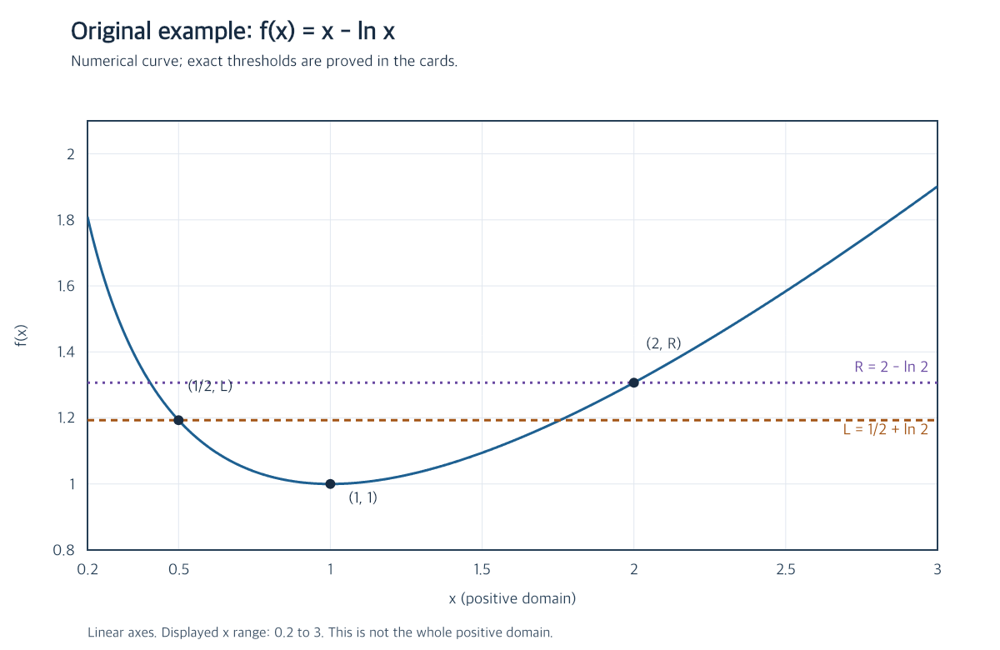

# 原创范围与计算依据

本套为 2026-10-16 编写的原创示例，不是真题、教材摘录或真实学生作业；不声称首创 $x-\ln x$ 这一常见函数及其数学性质。没有引用外部试卷、答案或受授权教材图片，也没有读取真实 Vault。

| 编号 | 对应文件 | 内容性质 |
| --- | --- | --- |
| M1 | [[01-变化区间上的最值|变化区间题]] | 本次组织的完整原创题面、分类与端点比较推导 |
| M2 | [[02-水平线与两个根|水平线题]] | 原创参数任务，使用标准的导数、连续性与极限知识 |
| M3 | [[03-有限区间的根数比较|有限区间题]] | 原创根数比较与开闭端点变式，大小关系证明为本次补写 |
| M4 | 本目录 `assets/x-minus-log.png` | 按 $y=x-\ln x$ 数值计算自绘，无外来图像、无 imagegen |

函数图横轴 $x\in[0.2,3]$，纵轴 $f(x)\in[0.8,2.1]$，等距取 1401 个横坐标。标出 $(1/2,1/2+\ln2),(1,1),(2,2-\ln2)$ 及两条端点高度虚线。坐标轴为线性刻度，曲线不展示定义域之外，也不表示整个正半轴。图上小数仅作定位，不代替正文的精确值与证明。

[[04-概念-单调分支与边界|概念卡]]、[[00-导读|导读]] 和 [[白板/章节.canvas|白板]] 是围绕上述题目本次编写的说明及辅助练习。白板含路线提示、没有答案记录；学生理解全部留空，不把参考推导称作学生成果。

文件组织参考同仓库的入门样本及阶段 7 约定；使用现有 Canvas 文档与组件合同，没有新增 Skill、数据库或专用实体类型。所有学习资料链接都在本目录内，完整复制即可阅读；界面、真实模型与实际学生学习效果须另行验收。

## M5—M10：函数结构拓展

[[05-母题-隐零点与高次代换|隐零点母题]]、[[06-反例-驻点不等于全局最值|驻点反例]]、[[07-母题-指对同构与单调性|同构母题]]、[[08-反例-同构函数不一定单射|非单射反例]]和[[09-切线放缩与失效边界|切线放缩]]的题目组织、解释与后续问题为本轮原创示例。隐函数关系降幂、单调性和指数对数不等式是标准数学方法，不声称原创发现。[[函数结构]]连接母题与反例，不另造教材出处。已有PNG原样沿用，没有新增图像。
