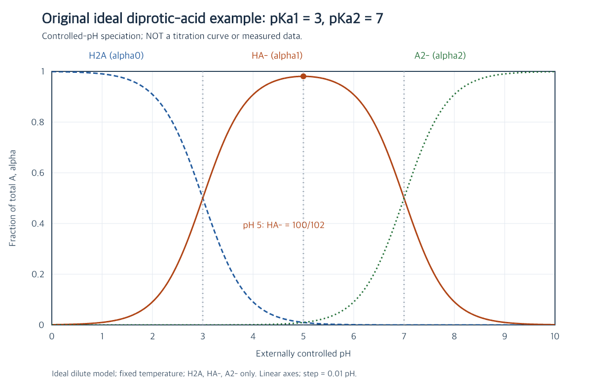

# pH 5 到底有多少中间形态

## 内容

### 原题

**原创理想模型题。** 二元弱酸 $\mathrm{H_2A}$ 在固定温度、理想稀溶液浓度近似下，$pK_{a1}=3,pK_{a2}=7$。只考虑 $\mathrm{H_2A,HA^-,A^{2-}}$，pH 由外部维持在 5，总分析浓度为 $1.00\,\mathrm{mmol\,L^{-1}}$。

求三形态的浓度比、各自占全部含 A 形态的分数，以及实际浓度。判断“这时中间形态占比最高，所以可以把它当成 100%”是否是精确结论，并说明此时是否为中间形态分数的最大点。

参考理解：尝试后再展开

## 参考理解

### 原解

**特征与联想。** pH 5 正在两个 $pK_a$ 的中间，但“中间”本身不是 100% 的依据。用相邻平衡的比值，可以在计算总分数前先看清三种物质的相对多少。

由理想平衡关系，

$$\frac{[\mathrm{HA^-}]}{[\mathrm{H_2A}]}=10^{5-3}=100,\qquad \frac{[\mathrm{A^{2-}}]}{[\mathrm{HA^-}]}=10^{5-7}=\frac1{100}.$$

所以三者浓度比是 $1:100:1$。**归一化的分母要包括三种形态**，因此

$$\alpha_0=\frac1{102},\qquad\alpha_1=\frac{100}{102}=\frac{50}{51}\approx0.980392,\qquad\alpha_2=\frac1{102}.$$

实际浓度依次为 $\tfrac1{102},\tfrac{100}{102},\tfrac1{102}\,\mathrm{mmol\,L^{-1}}$，约为 $0.009804,0.980392,0.009804\,\mathrm{mmol\,L^{-1}}$，总和仍是题设总浓度。$100/101$ 漏掉了一种端形态，100% 则抹掉了两种仍然存在的少量成分。

**证明最大，而不只看图。** 由 [[01-从平衡到分布系数|分布公式]]，

$$\alpha_1=\frac1{1+H/K_{a1}+K_{a2}/H}.$$

两项正数之和满足 $H/K_{a1}+K_{a2}/H\geq2\sqrt{K_{a2}/K_{a1}}=0.02$，等号要求 $H=\sqrt{K_{a1}K_{a2}}=10^{-5}$。分母在此最小，故 $\alpha_1$ 最大值恰为 $1/1.02=100/102$，对应 pH 5。

图中横轴是外部指定的 pH，纵轴是分布分数 $\alpha$，不是酸碱滴定体积或浓度。英文图例 H2A、HA-、A2- 分别对应三种形态；pH 5 的标记给出中间形态最大值。图是公式的数值投影，不是实验测量。

**边界。** 如果题目允许约 2% 的分数误差，98.04% 可被说明为近似几乎全部；要求精确值或涉及少量形态的反应时，不能直接删去余下部分。对于一般二元酸，中间形态最大点在同一理想模型下仍为两 $pK_a$ 的平均值，但最大分数随 $K_{a2}/K_{a1}$ 改变，不固定为本题的数值。下一题 [[03-优势形态与图像边界|优势形态与图像边界]] 比较“最多”与“超过 90%”。

### 下次探讨

若两个 $pK_a$ 更接近，中间形态的最大分数会怎样变化？先用公式预测，再考虑是否需要重新画图。

返回 [[00-导读|导读]]；原创题、数值与图见 [[06-来源说明|来源说明 C2、C4]]。

## 学生理解
