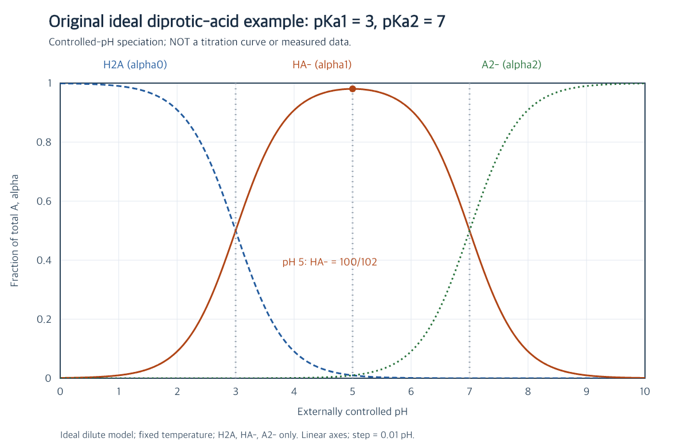

# 原创理想模型与自绘图说明

本套于 2026-10-16 编写，题面、参考推导、语句与图均为原创示例，不是教材、真题或实际实验记录。$\mathrm{H_2A}$ 只是形式符号，不对应已核验的真实化合物；$pK_{a1}=3,pK_{a2}=7$ 是本次设定。标准平衡关系与守恒方法属于一般化学知识，不声称本次首创。

| 编号 | 对应文件 | 原创范围 |
| --- | --- | --- |
| C1 | [[01-从平衡到分布系数|平衡与分布]] | 理想模型完整题设，方括号标准浓度约定、公式推导与条件说明 |
| C2 | [[02-pH5到底有多少中间形态|pH 5]] | 精确比例、实际浓度与中间形态最大值证明 |
| C3 | [[03-优势形态与图像边界|优势形态与边界]] | 最大、90% 门槛、相交点与滴定图边界的比较任务 |
| C4 | `assets/diprotic-distribution.png` | 用本页公式数值计算并自绘，非外部图片、非 imagegen、非实验数据 |

## 图像如何得到

对每个受控 pH，令 $H=10^{-\mathrm{pH}}$、$D=H^2+10^{-3}H+10^{-10}$，依次绘制 $H^2/D$、$10^{-3}H/D$、$10^{-10}/D$。pH 从 0 到 10，步长 0.01，共 1001 个采样点；横纵轴均为线性刻度，纵轴分数范围 0 到 1。英文图例 H2A、HA-、A2- 对应三种含 A 形态。标出 pH 3、5、7，pH 5 中间分数为精确的 $100/102$。图中近似标签不改变正文精确值。

本图假定固定温度、理想稀溶液浓度近似、只有三种含 A 形态，pH 由外部指定。没有假定“纯酸自身平衡 pH 可以任意独立指定”，也没有模拟添加碱、体积变化或滴定当量点。图不能用作滴定曲线或真实实验方案。

[[00-导读|导读]]、[[04-概念-比值与归一化|概念卡]] 与 [[白板/章节.canvas|白板]] 为本次原创组织。白板只是辅助任务，未填入学生答案；所有学生理解留空。文件组织参照本仓库入门样本与阶段 7，未新增 Skill、数据库或实体类型，也未读取真实 Vault。完整复制本目录即可保留所有本地链接与图片。

## C5—C10：守恒、读图与配位拓展

[[05-物料守恒与电荷守恒|物料与电荷]]、[[06-质子条件与参考形态|质子条件]]、[[07-两性盐的pH不是外部旋钮|NaHA自身平衡]]、[[08-交点与对数比值读图|交点读图]]、[[09-从Bronsted到Lewis配位|配位比较]]为本轮原创任务与参考解释。NaHA计算沿用形式酸，另指定Kw及投料浓度；Brønsted/Lewis定义与列举的标准反应属于一般化学知识，不声称原创发现或引用某一本教材。无水BF₃加合只作概念示意，无实验操作指导；配位未给定形成常数，不断言定量转化。

[[守恒与酸碱视角]]连接这些视角。白板figure直接使用本页分布公式并提供交点点选，与原PNG同源；没有重新生成图片，没有引入真实物质的实验数据。
