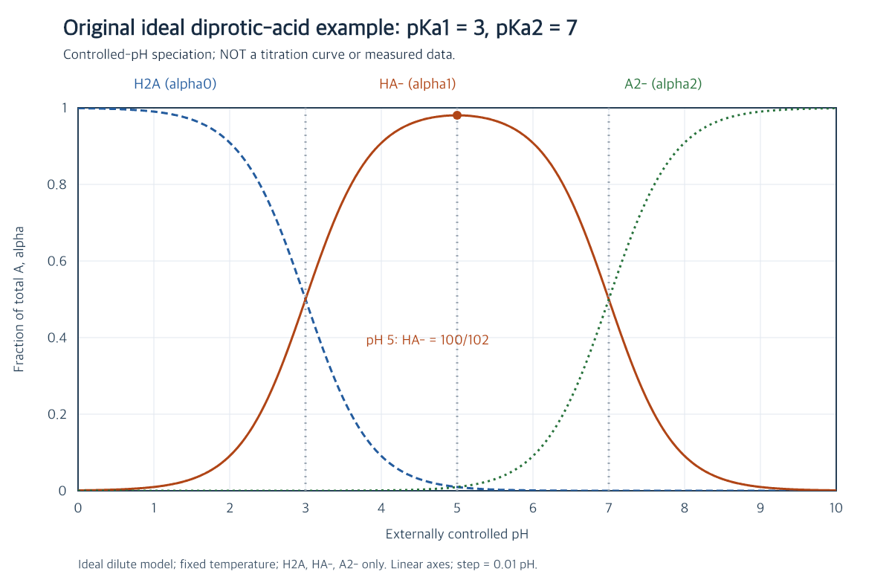

# 交点与对数比值读图

## 内容

### 原题

**原创理想模型题。** 固定温度、理想浓度近似，二元弱酸 $pK_{a1}=3,pK_{a2}=7$，pH 外部受控，只有 H₂A、HA⁻、A²⁻ 三种含 A 形态。在已有分布图上找相邻曲线的交点，求横坐标及相交两种形态的分数。H₂A 与 A²⁻ 相交于 pH 5，是否意味着存在 $pK_a=5$？“图上斜率为 1”适用于哪一种纵轴？

参考理解：把交点翻译回一条平衡式

## 参考理解

### 原解

相邻两形态之比来自对应一级解离：

$$\frac{[\mathrm{HA^-}]}{[\mathrm{H_2A}]}=10^{\mathrm{pH}-3},\qquad
\frac{[\mathrm{A^{2-}}]}{[\mathrm{HA^-}]}=10^{\mathrm{pH}-7}.$$

第一个比等于 1 时 pH=3，第二个比等于 1 时 pH=7。因此相邻曲线交点横坐标分别给出相应 pKa。pH=3 时比例 $1:1:10^{-4}$，前两者各占 $1/(2+10^{-4})\approx0.499975$；pH=7 时比例反转，后两者也各占这个分数。第三种形态很少却没有严格消失，不能把交点纵坐标精确写成 1/2。

非相邻两端相等要求 $H^2=K_{a1}K_{a2}$，因此 pH=5。此时比例为 $1:100:1$，两端各占 $1/102$。这是两级关系共同产生的交点，并没有多出第三个酸解离常数。

对第一条比值关系取常用对数，才得到

$$\log_{10}\frac{[\mathrm{HA^-}]}{[\mathrm{H_2A}]}=\mathrm{pH}-3.$$

若横轴为 pH、纵轴为这个**对数比值**，图线是斜率 1 的直线。已有图片的纵轴却是 $\alpha_i$，曲线的斜率随位置变化，不是 1。读图前先辨认坐标定义，比直接背曲线形状更可靠。

到 [[白板/章节.canvas|白板]] 点出 H₂A 与 HA⁻ 的交点，再用一句平衡关系解释横坐标。点选记录只表示你选择的位置，不能代替理由或自动判定整题掌握。

### 下次探讨

若只看见两条相交曲线却不知道对应哪两种物种，为什么还不能直接把交点横坐标称为某一级 pKa？

来源见 [[06-来源说明|集中来源说明]]。

## 学生理解
